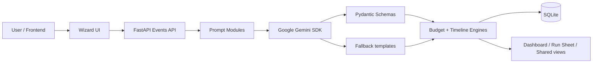

# EventPilot

EventPilot is a lightweight event-planning assistant for weddings, birthdays, and community events. It combines a FastAPI backend, deterministic planning engines, and a Vite + React frontend to create event plans from user input and AI suggestions while verifying the outputs in code before accepting them.

## Problem and solution

Planning an event usually mixes subjective creativity with spreadsheet-like operational checks: budgets, guest counts, dates, tasks, and vendor requirements all need to stay consistent. EventPilot addresses that by:

- collecting the event details through a guided wizard,
- generating structured AI suggestions for budget splits, ideas, and vendor categories,
- validating the AI output with Pydantic schemas,
- running deterministic Python engines to turn those suggestions into exact totals and timeline tasks,
- falling back to rule-based templates when Gemini is unavailable or misconfigured.

This keeps the product resilient even when the AI layer is down while still giving the app a strong planning-assistant experience.

## Feature list

- Event CRUD and detail API under `/api/v1/events`
- Plan generation endpoint at `/api/v1/events/{id}/generate-plan`
- AI structured generation with retries and JSON-schema validation
- Deterministic budget allocator with exact totals and contingency logic
- Timeline builder with dependency ordering and deadline calculations
- Rule-based fallback output for budget, ideas, and vendor categories
- Frontend wizard, plan dashboard, run-sheet view, and shared page routes
- Basic security protections: input sanitization, CORS allow-list, rate limiting, secret-backed settings

The project explicitly follows the principle: AI proposes, code verifies.

## Architecture



## Tech choices and reasons

- FastAPI: small, testable API surface with Pydantic validation and lightweight route definitions.
- SQLite: simple local persistence for event records and generated plan data during development and demos.
- Google GenAI SDK: structured JSON output for AI planning suggestions using type-safe schemas.
- Pydantic models: schema enforcement and validation before saving or using AI content in deterministic logic.
- React + Vite + TypeScript: quick UI iteration with typed API calls and testable components.
- SlowAPI: simple rate limiting without extra infrastructure.
- Python engines: deterministic budget and timeline logic that does not depend on database access or LLM calls.

## Setup in 5 commands or fewer

Local development:

```bash
cp backend/.env.example backend/.env
cp frontend/.env.example frontend/.env
cd backend && python -m pip install -r requirements.txt
cd ../frontend && npm install
```

Then start both services:

```bash
cd backend && uvicorn app.main:app --reload --host 0.0.0.0 --port 8000
cd frontend && npm run dev -- --host 0.0.0.0 --port 5173
```

Docker:

```bash
docker compose up --build
```

## Environment variables

| Variable | Example | Purpose |
| --- | --- | --- |
| GEMINI_API_KEY | "" | API key for Google Gemini; if empty, the app falls back to deterministic templates. |
| GEMINI_MODEL | "gemini-2.5-flash" | Model used by the structured generation client. |
| DATABASE_URL | "sqlite:///./events.db" | SQLite database connection string. |
| ALLOWED_ORIGINS | "[\"http://localhost:5173\"]" | Allowed frontend origins for CORS. |
| RATE_LIMIT_DEFAULT | "100/minute" | Default SlowAPI rate limiter setting. |
| API_V1_STR | "/api/v1" | API prefix for versioned routes. |
| VITE_API_URL | "http://localhost:8000" | Frontend API base URL. |

## API overview

The current codebase exposes these endpoints:

- `POST /api/v1/events` — create an event
- `GET /api/v1/events` — list events
- `GET /api/v1/events/{event_id}` — fetch event details
- `PATCH /api/v1/events/{event_id}` — update event metadata
- `DELETE /api/v1/events/{event_id}` — delete an event
- `POST /api/v1/events/{event_id}/generate-plan` — create budget, tasks, and vendor recommendations
- `GET /api/v1/events/{event_id}/plan` — retrieve the generated plan
- `GET /health` — app health check

The frontend also contains route-level UI for a wizard, dashboard, run sheet, and shared view, but the backend route surface stays focused on event planning and plan generation.

## Tests and validation

Run the project checks from their respective roots:

```bash
cd backend && pytest -q
cd frontend && npm test -- --run
cd frontend && npm run lint
cd frontend && npm run build
```

## Accessibility and security notes

- Inputs are sanitized in the backend to strip HTML/script-like content.
- Rate limiting is enabled on event and plan endpoints.
- CORS is restricted by config instead of allowing every origin.
- Structured outputs are validated before use and AI failures fall back to deterministic templates.
- The frontend and backend both keep accessibility concerns front-of-mind: labels, focus states, and resilient screen-reader-friendly component states.

## Limitations

- This project is a working prototype focused on event planning and deterministic verification, not a full production SaaS feature set.
- The current backend route surface covers core event planning and plan generation; the broader advanced Plan B, vendor-share, and expanded multi-router features are not all wired as public API endpoints in the code that is currently committed.
- AI generation still depends on Gemini availability or the fallback path; the fallback gives deterministic, rule-based output but is intentionally simpler than a full production planning engine.

## Future scope

- Additional endpoint families for vendor brief generation, risk simulation, share links, and richer collaborative editing
- More advanced forecasting for budgets, gift lists, staffing, and guest logistics
- Deeper event-type-specific scheduling templates and analytics
- Expanded frontend state management and persistence for multi-step editing workflows

## Documentation index

- [System design](docs/DESIGN.md)
- [Prompt reference](docs/PROMPTS.md)
- [Demo script](docs/DEMO.md)
- [Requirement checklist](docs/CHECKLIST.md)
- [Architecture](docs/ARCHITECTURE.md)
- [Security](docs/SECURITY.md)
- [Accessibility](docs/ACCESSIBILITY.md)
