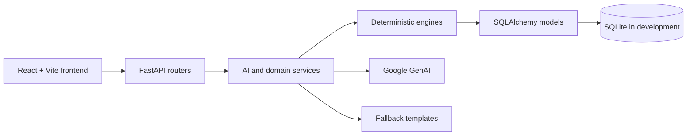

# Architecture

EventPilot uses a layered FastAPI backend and a React frontend.

## Layers

- **Frontend**: `frontend/src` contains the wizard, dashboard, Plan B, run
  sheet, and shared-view pages. API calls are centralized in the client.
- **Routers**: `backend/app/routers` validates HTTP input, coordinates
  services/engines, and serializes responses.
- **Services**: `backend/app/services` owns AI calls, schema validation,
  deterministic fallback selection, and plan orchestration. Fallback data is
  separated into `*_fallbacks.py` modules, while `plan_service.py` owns plan
  persistence orchestration.
- **Engines**: `backend/app/engines` contains pure budget, timeline, and run
  sheet calculations. Timeline templates are split into event-specific
  `*_templates.py` modules. Engines do not call the LLM or database.
- **Models and database**: `backend/app/models` and `backend/app/db` persist
  events and generated plan records through SQLAlchemy.
- **Schemas and prompts**: `backend/app/schemas` defines API and AI contracts;
  `backend/app/prompts` contains versioned prompt builders.
- **Frontend components**: `frontend/src/components` contains focused
  presentational components. Wizard steps and dashboard tabs are separated from
  their page containers so state and rendering responsibilities remain clear.

## Plan data flow

1. The frontend submits an event to the events API.
2. The plan router requests structured AI suggestions when a Gemini key is
   configured.
3. Invalid or unavailable AI output uses the matching deterministic fallback.
4. Budget and timeline engines normalize the suggestions into exact,
   dependency-ordered records.
5. The router persists the generated records and returns the plan payload.
