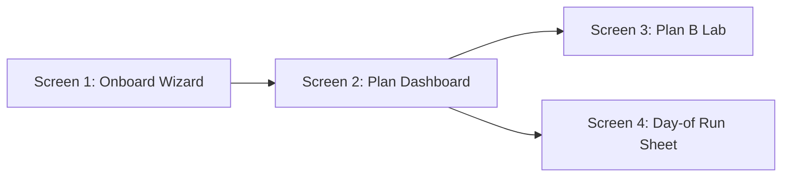
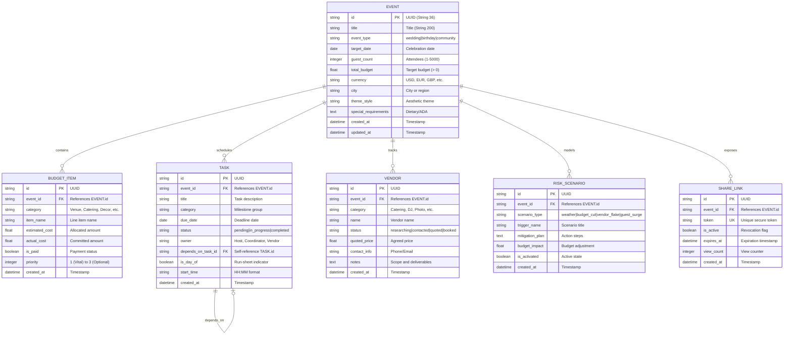
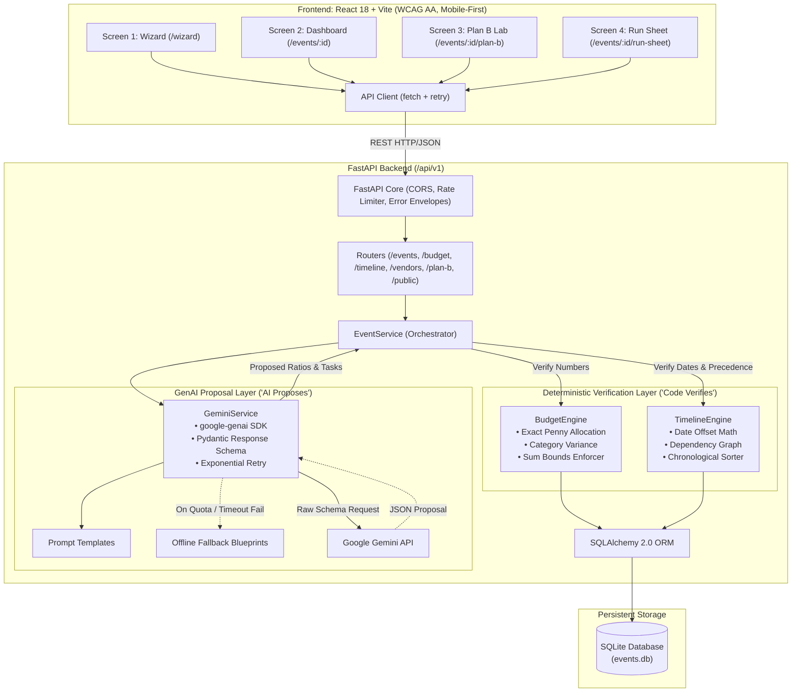

# EventPilot — System Design Document
**PromptWars Challenge 5: Celebration & Event Planner**

---

## 1. User Flows Across 4 Screens (3 Event Types)

EventPilot enforces a strict maximum of **4 streamlined, mobile-first, jargon-free screens**:
1. **Screen 1: Onboard Wizard (`/wizard`)** — 7-step guided questionnaire with dynamic smart defaults.
2. **Screen 2: Plan Dashboard (`/events/:id`)** — Master control center featuring budget progress, milestones, vendor status, and AI-curated themes.
3. **Screen 3: Plan B Lab (`/events/:id/plan-b`)** — Interactive contingency stress-tester that recalculates budget, tasks, and safety protocols deterministically.
4. **Screen 4: Day-of Run Sheet (`/events/:id/run-sheet`)** — Minute-by-minute execution schedule with role filters, contact badges, and a high-contrast print/export mode.



### Event Type User Flows

#### A. Wedding Flow
- **Wizard**: Selects "Wedding", picks date 9 months out, 130 guests, $28,000 USD budget in Seattle, WA. Theme: "Rustic Elegant". Requirements: Stage ramp, vegetarian options.
- **Dashboard**: Allocations automatically calculated (Catering 40%, Venue 28%, Photo/Video 15%, Floral/Decor 10%, Contingency 7%). Milestone tasks created with dependencies (Book venue before caterer). Curated ideas display neutral palette and signature spritz recipes.
- **Plan B Lab**: Host tests "Torrential Rain" scenario. System automatically shifts outdoor lawn ceremony to covered pavilion, checks tent vendor availability, and recalculates line-item cost buffers.
- **Run Sheet**: Chronological order: 08:00 Hair & Makeup, 13:30 First Look, 15:30 Ceremony, 17:00 Cocktail Hour, 18:30 Dinner, 23:00 Send-Off. Host and coordinator contact badges attached.

#### B. Milestone Birthday Flow
- **Wizard**: Selects "Birthday", date 4 weeks out, 35 guests, $2,200 USD budget in Austin, TX. Theme: "Cyberpunk Neon / 80s Arcade". Requirements: Gluten-free cake.
- **Dashboard**: Budget prioritizes venue/tokens (40%), bar & bites (45%), cake & neon styling (15%). Milestones compressed into 4 weekly sprints. Curated ideas suggest retro synthwave playlists and arcade prize party favors.
- **Plan B Lab**: Host tests "Guest Count Surge (+25%)". Engine recalculates food/drink minimums and alerts host if headcount exceeds private room capacity.
- **Run Sheet**: 17:00 Host Setup, 18:30 Guest Arrival & Token Pass, 20:00 Cake & Toast, 22:30 Teardown & Tab Settlement.

#### C. Community Event Flow
- **Wizard**: Selects "Community", date 3 months out, 350 attendees, $6,000 USD budget in Denver, CO. Theme: "Neighborhood 5K & Eco-Fair". Requirements: ADA-compliant course, compost stations.
- **Dashboard**: Budget partitions City Permits/Safety (25%), Course Rentals/Hydration (35%), Sound/Stage (20%), Promotions (20%). Timeline sequences municipal permit submissions first (hard dependency).
- **Plan B Lab**: Organizer tests "Severe Heat Advisory". Engine adds misting tents, doubles hydration station costs, and updates volunteer safety checklist.
- **Run Sheet**: 06:00 Street Closure & Course Setup, 07:30 Volunteer Briefing, 08:30 Race Kickoff, 11:00 Awards & Fair, 14:00 Cleanup & Road Reopening.

---

## 2. Wizard Questions (Max 7, Smart Defaults)

| Step | Field | Question Label | Control Type | Smart Defaults (Wedding / Birthday / Community) | Validation & Constraints | WCAG Accessibility / Helper Text |
| :--- | :--- | :--- | :--- | :--- | :--- | :--- |
| **1** | `event_type` | *"What are we celebrating?"* | Visual Segmented Cards | `wedding` / `birthday` / `community` | Required, enum string. | Keyboard arrow navigation, `aria-pressed` states. |
| **2** | `target_date` | *"When is the big day?"* | HTML5 Date Picker | +6 months / +4 weeks / +3 months | Must be today or future date (`YYYY-MM-DD`). | Screen-reader announces day of the week automatically. |
| **3** | `guest_count` | *"How many people are attending?"* | Stepper + Quick Pills (20, 50, 100, 250) | `100` / `30` / `200` | Integer, min `1`, max `5,000`. | Descriptive `aria-label="Guest count stepper"`. |
| **4** | `budget` & `currency` | *"What is your target budget?"* | Currency Select + Number Input | USD ($) \| `$20,000` / `$2,000` / `$5,000` | Float > `0.00`. Formatted to 2 decimals. | Currency symbols mapped to ISO codes (`USD`, `EUR`, `GBP`, `CAD`, `AUD`, `INR`, `JPY`). |
| **5** | `city` | *"Where will this take place?"* | Text Input with Sanitization | `"Seattle, WA"` / `"Austin, TX"` / `"Denver, CO"` | Min 2 chars, sanitized string. | `aria-autocomplete="list"`. |
| **6** | `theme_style` | *"What vibe or style do you envision?"* | Tag Cloud + Custom Text Field | Wedding: *"Warm Minimalist"*<br>Birthday: *"Retro Arcade"*<br>Community: *"Eco Fair"* | Max 150 characters. | Multi-select chips with toggle state announcements. |
| **7** | `special_requirements` | *"Any must-haves, dietary, or accessibility needs?"* | Multi-checkbox + Notes box | `[x] Wheelchair Accessible`<br>`[x] Vegetarian/Gluten-Free Options` | Sanitized text, max 500 chars. Optional. | Clear helper text: *"Helps us prioritize vendor checks and safety."* |

---

## 3. Feature Breakdown

### MUST-HAVE
- **Deterministic Budget Allocator**: Proposes percentage breakdown per event type; deterministic engine verifies that line items equal total budget to the exact penny.
- **Milestone Timeline Generator**: Calculates calendar deadlines working backward from target date; manages task dependencies (`depends_on`).
- **Vendor Checklist**: Categorized requirements with statuses (`researching`, `contacted`, `quoted`, `booked`).
- **Personalized Ideas**: AI-curated palettes, music vibes, and signature food/drink concepts matching the chosen theme.
- **Resilient AI Pipeline**: LLM calls structured via Pydantic; deterministic local fallback templates guarantee plan generation with zero downtime.

### WOW Features
- **Plan B Contingency Engine**: 1-click simulations for Weather, Budget Cuts, Vendor Flakes, and Guest Surges with instant recalculations.
- **Interactive What-If Budget Sliders**: Frontend sliders dynamically adjust allocations; code enforces budget ceiling and flags deficits.
- **1-Click Vendor Brief Generator**: Generates formatted, ready-to-send Markdown/Text briefs with scopes, deadlines, and budget limits.
- **Minute-by-Minute Run Sheet**: Detailed day-of schedule with contact phone/role tags, status checkboxes, and print layout.
- **Shareable Read-Only Link**: Secure tokenized URL (`/share/:token`) for clients and collaborators without authentication.

### CUT-IF-SHORT-ON-TIME
- Automated outbound email dispatch to vendors.
- Live vendor pricing scraper or marketplace APIs.
- Real-time WebSocket multi-user collaborative cursor editing.
- Image receipt OCR expense parsing.

---

## 4. Relational Data Model

Database: **SQLite** via **SQLAlchemy 2.0 ORM**.



---

## 5. REST API Table (`/api/v1`)

| Method | Path | Request Body / Parameters | Response Status & Body | Description |
| :--- | :--- | :--- | :--- | :--- |
| `POST` | `/api/v1/events` | `EventCreate` | `201 Created` ➔ `EventResponse` | Creates a raw event record. |
| `GET` | `/api/v1/events` | None | `200 OK` ➔ `List[EventResponse]` | Lists all created events. |
| `GET` | `/api/v1/events/{id}` | `id: str` (UUID) | `200 OK` ➔ `EventDetailResponse` | Full event details with nested relations. |
| `PATCH` | `/api/v1/events/{id}` | `EventUpdate` | `200 OK` ➔ `EventResponse` | Partial update of event parameters. |
| `DELETE` | `/api/v1/events/{id}` | `id: str` (UUID) | `200 OK` ➔ `{"message": "Event deleted"}` | Cascading delete of event and relations. |
| `POST` | `/api/v1/events/generate` | `EventCreate` | `201 Created` ➔ `EventDetailResponse` | Generates verified plan (AI proposal + code verification). |
| `POST` | `/api/v1/events/{id}/budget/rebalance` | `BudgetRebalanceRequest` | `200 OK` ➔ `BudgetSummaryResponse` | Deterministically recalculates category allocations. |
| `POST` | `/api/v1/events/{id}/budget/items` | `BudgetItemCreate` | `201 Created` ➔ `BudgetItemResponse` | Adds a custom budget line item. |
| `PATCH` | `/api/v1/events/{id}/budget/items/{item_id}` | `BudgetItemUpdate` | `200 OK` ➔ `BudgetItemResponse` | Updates cost or payment status. |
| `GET` | `/api/v1/events/{id}/timeline` | `id: str` (UUID) | `200 OK` ➔ `List[TaskResponse]` | Returns sorted timeline with dependency status. |
| `GET` | `/api/v1/events/{id}/run-sheet` | `id: str` (UUID) | `200 OK` ➔ `RunSheetResponse` | Returns day-of chronological schedule. |
| `PATCH` | `/api/v1/events/{id}/tasks/{task_id}` | `TaskUpdate` | `200 OK` ➔ `TaskResponse` | Updates task status or owner. |
| `POST` | `/api/v1/events/{id}/vendors/{category}/brief`| None | `200 OK` ➔ `VendorBriefResponse` | Generates ready-to-send vendor inquiry brief. |
| `POST` | `/api/v1/events/{id}/plan-b/{scenario_id}/activate` | None | `200 OK` ➔ `EventDetailResponse` | Applies contingency plan to budget & tasks. |
| `POST` | `/api/v1/events/{id}/share` | None | `201 Created` ➔ `ShareLinkResponse` | Generates secure read-only token link. |
| `GET` | `/api/v1/public/share/{token}` | `token: str` | `200 OK` ➔ `PublicPlanResponse` | Sanitized public view of event plan. |

---

## 6. Project Folder Structure

```
eventpilot/
├── .env.example
├── .gitignore
├── README.md
├── docker-compose.yml
├── .github/
│   └── workflows/
│       └── ci.yml
├── docs/
│   └── DESIGN.md
│
├── backend/
│   ├── .env.example
│   ├── Dockerfile
│   ├── pytest.ini
│   ├── requirements.txt
│   ├── app/
│   │   ├── __init__.py
│   │   ├── main.py
│   │   ├── core/
│   │   │   ├── __init__.py
│   │   │   ├── config.py
│   │   │   └── security.py
│   │   ├── db/
│   │   │   ├── __init__.py
│   │   │   ├── session.py
│   │   │   └── models.py
│   │   ├── schemas/
│   │   │   ├── __init__.py
│   │   │   ├── common.py
│   │   │   ├── event.py
│   │   │   ├── budget.py
│   │   │   ├── task.py
│   │   │   ├── vendor.py
│   │   │   ├── risk.py
│   │   │   └── share.py
│   │   ├── engines/
│   │   │   ├── __init__.py
│   │   │   ├── budget_engine.py
│   │   │   └── timeline_engine.py
│   │   ├── services/
│   │   │   ├── __init__.py
│   │   │   ├── gemini_service.py
│   │   │   └── event_service.py
│   │   ├── prompts/
│   │   │   ├── __init__.py
│   │   │   └── event_prompts.py
│   │   ├── templates/
│   │   │   ├── __init__.py
│   │   │   └── fallbacks.py
│   │   └── routers/
│   │       ├── __init__.py
│   │       ├── events.py
│   │       ├── budget.py
│   │       ├── timeline.py
│   │       ├── vendors.py
│   │       ├── plan_b.py
│   │       └── public.py
│   └── tests/
│       ├── __init__.py
│       ├── conftest.py
│       ├── test_events_crud.py
│       ├── test_validation_edge_cases.py
│       ├── test_budget_engine.py
│       └── test_timeline_engine.py
│
└── frontend/
    ├── Dockerfile
    ├── index.html
    ├── package.json
    ├── vite.config.js
    ├── public/
    └── src/
        ├── App.jsx
        ├── main.jsx
        ├── index.css
        ├── components/
        │   ├── Header.jsx
        │   ├── Modal.jsx
        │   ├── ProgressBar.jsx
        │   └── Toast.jsx
        ├── screens/
        │   ├── WizardScreen.jsx
        │   ├── DashboardScreen.jsx
        │   ├── PlanBLabScreen.jsx
        │   └── RunSheetScreen.jsx
        ├── services/
        │   └── api.js
        ├── hooks/
        │   └── useEventPlan.js
        ├── styles/
        │   └── tokens.css
        └── types/
            └── index.js
```

---

## 7. Mermaid Architecture Diagram


